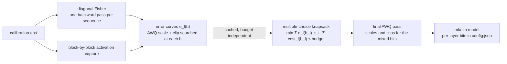
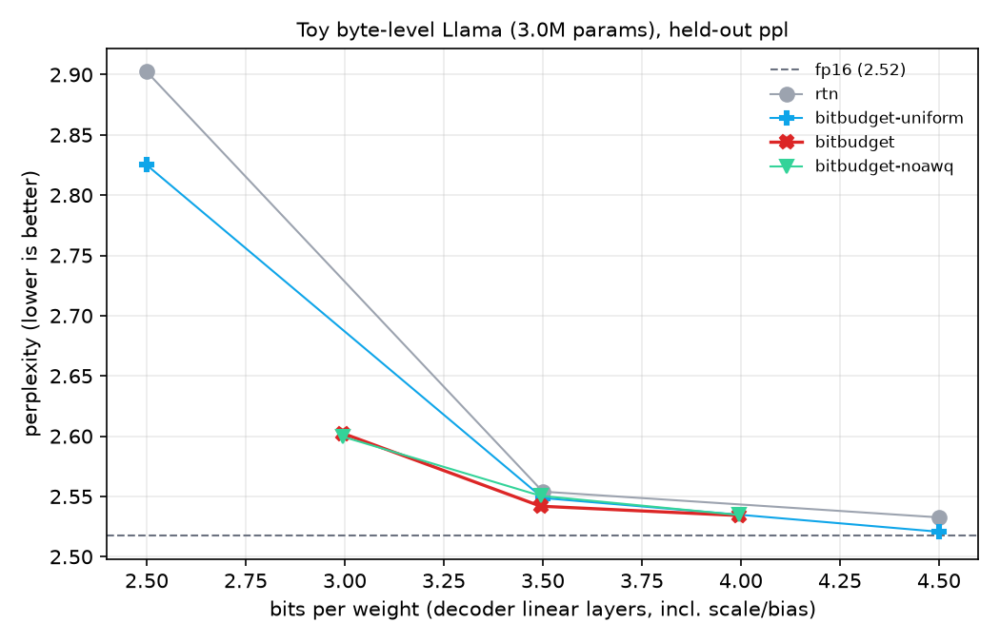
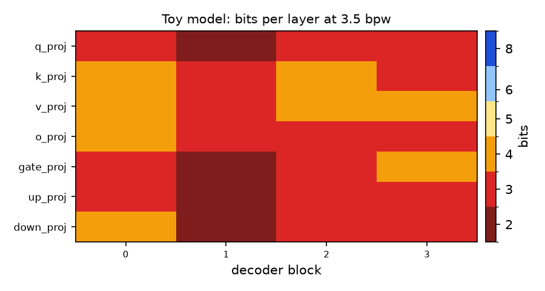

# BitBudget

**Salience-guided mixed-precision quantization for on-device LLMs on Apple silicon (MLX).**

BitBudget extends [AWQ](https://arxiv.org/abs/2306.00978) (Activation-aware Weight Quantization, MLSys 2024) from *which channels inside a layer matter* to *how many bits each layer deserves*. Given a memory budget such as "3.5 bits per weight", it chooses a bit-width from {2, 3, 4, 5, 6, 8} for every linear layer of a transformer. The objective is to minimize the predicted loss increase, with AWQ scaling and clipping searched for each layer's final bit-width. The output is a standard MLX model that `mlx_lm.load` / `mlx_lm.generate` run unchanged.

```bash
bitbudget quantize --model Qwen/Qwen2.5-0.5B --target-bpw 3.5 --out qwen-bb3.5
mlx_lm.generate --model qwen-bb3.5 --prompt "Explain unified memory in one sentence."
```

---

## Why

On a phone or laptop, memory is a fixed budget, and decoding is memory-bandwidth-bound: every generated token streams all of the weights. Fewer bits per weight therefore mean both fitting the model in RAM and generating faster.

Uniform quantization spends that budget evenly. Some layers barely notice 2-bit weights while others fall apart below 4 bits, so uniform 4-bit wastes bits on robust layers and starves sensitive ones. Apple has described mixing 2-bit and 4-bit weights for its on-device foundation model for exactly this reason. BitBudget makes that trade-off an explicit optimization problem.

## How it differs from what's already in mlx-lm

mlx-lm ships several learned quantizers. BitBudget is meant to sit next to them, so the comparison matters:

| | bit-widths | how layers get their bits | sensitivity signal | AWQ scaling/clipping |
|---|---|---|---|---|
| `mlx_lm.convert -q` | 1 | uniform | none | no |
| `--quant-predicate mixed_3_6` etc. | 2 | fixed hand-written rule | none | no |
| `mlx_lm.awq` | 1 | uniform | n/a | yes |
| `mlx_lm.dynamic_quant` | 2 (low/high) | sensitivity threshold | 1st-order gradient alignment, measured with RTN weights | no |
| **BitBudget** | **any subset of {2,3,4,5,6,8}** | **exact multiple-choice knapsack** | **2nd-order (diagonal Fisher) loss estimate, measured *after* AWQ at every candidate bit-width** | **yes, re-searched for the final mixed allocation** |

Two practical consequences:

* **Sensitivity is AWQ-aware.** A layer that looks fragile under round-to-nearest may be fine once its salient channels are scaled. BitBudget measures each layer's error curve with AWQ applied at each bit-width, so the allocator prices layers by their best achievable error.
* **One calibration pass gives the whole frontier.** The error curves don't depend on the budget, so they are cached (`--curves curves.json`). Re-allocating for a new budget is a millisecond knapsack solve plus one cheap AWQ pass.

## Method



**1. AWQ at a given bit-width.** Layers that read the same activation (q/k/v after `input_layernorm`; gate/up after `post_attention_layernorm`; down after up) share a per-channel scale `s = mean|x|^α`. α is grid-searched to minimize the error of the *block* output (the whole attention module for q/k/v, so the search sees the softmax), with each layer quantized at its own bit-width:

```
min_α  || f(x; W) − f(x / s; Q_b(W · s)) ||²
```

The scale is folded into the preceding norm or linear layer, so it costs nothing at inference. `α = 0` (plain round-to-nearest) is always a candidate, so the search never does worse than RTN on the calibration data. Afterwards, a per-group clipping range is searched (skipping q/k, which feed the softmax). Clipping happens before `mx.quantize`, so the output is ordinary MLX affine quantization.

**2. How much does layer `l` at `b` bits hurt?** A second-order Taylor expansion with the diagonal empirical Fisher as the Hessian (as in Optimal Brain Damage and HAWQ):

```
e_l(b) = ½ Σ F_l ⊙ (Q_b(W_l) − W_l)²,     F_l = E[(∂L/∂W_l)²]
```

Unlike a layer-local MSE, this is measured in units of the model's loss, so errors from different layers can be traded against each other. When AWQ folds `W → W · s`, the Fisher is transformed as `F → F / s²`, which keeps the estimate invariant (`tests/test_awq.py::test_fisher_rescaling_is_invariant`). A cheaper layer-local estimator (`--sensitivity output`) is included as an ablation.

**3. Allocation.** Each layer picks one option, costing `n_l · (b + 32/group_size)` bits including the bf16 scale and bias per group. Minimizing `Σ e_l(b_l)` under the budget is a multiple-choice knapsack, solved exactly by dynamic programming over discretized cost. Costs are rounded up, so the budget is never exceeded. A Lagrangian solver is also provided. The DP is checked against brute force on random instances (`tests/test_allocate.py`).

**4. Export.** The per-layer bits are written into `config.json` in mlx-lm's native per-layer quantization format, so the model loads with `mlx_lm.load` with no custom code.

## Quickstart (Apple silicon)

```bash
git clone https://github.com/JayaChandraDadi/bitbudget && cd bitbudget
python -m venv .venv && source .venv/bin/activate
pip install -e ".[dev]"

# quantize at a budget (curves are cached for reuse at other budgets)
bitbudget quantize --model Qwen/Qwen2.5-0.5B --target-bpw 3.5 \
    --curves runs/q05/curves.json --out runs/q05/bb3.5

# quality + speed: WikiText-2 perplexity, KL to fp16, TTFT, decode tok/s, peak memory
bitbudget eval --model runs/q05/bb3.5 --method bitbudget --reference Qwen/Qwen2.5-0.5B \
    --bench --results runs/q05/results.jsonl

# the full comparison: fp16, RTN, mlx-lm mixed presets, mlx_lm.awq,
# mlx_lm.dynamic_quant, BitBudget at several budgets, and ablations
MODEL=Qwen/Qwen2.5-0.5B ./scripts/run_sweep.sh

# energy per token via powermetrics (asks for sudo)
./scripts/measure_energy.sh runs/Qwen2.5-0.5B/bb3.5 bb3.5 runs/Qwen2.5-0.5B/results.jsonl
```

Useful `quantize` flags: `--bits 2,3,4,6,8` (candidate set; a single value gives uniform AWQ), `--target-bpw` (budget for decoder linear layers, *including* scale/bias overhead, so uniform 4-bit at group size 64 is 4.5), `--embed-bits`, `--sensitivity fisher|output`, `--solver dp|lagrangian`, `--no-awq`, `--no-clip`.

**Memory.** The Fisher pass holds float32 squared gradients for every linear weight (about 2× the bf16 model size), on top of the backward pass. On a 16 GB Mac, 0.5B–1.5B models are comfortable. Supported architectures: Llama, Mistral, Qwen2, Qwen3.

## Results

### Toy-scale validation (measured, reproducible anywhere)

A 3.0M-parameter byte-level Llama (4 blocks, hidden 256, grouped-query attention, SwiGLU) trained on Python standard-library source, with ~10% of files held out by a deterministic hash split. It was trained with JAX ([`examples/train_toy_jax.py`](examples/train_toy_jax.py); exported weights reproduce the JAX logits in MLX to 1e-5) and quantized from bf16 with the same code path used for real models. Calibration uses 8 × 256 bytes from training files. Perplexity is per byte on 100 × 256 held-out bytes, evaluating the quantized weights in fp32 for every method, including the unquantized reference. Embeddings are kept at 8 bits throughout. Bits per weight are for the decoder linear layers, including scale/bias overhead.

| bits/weight | RTN (uniform) | AWQ (uniform, ours) | **BitBudget** | BitBudget w/o AWQ | BitBudget, layer-local sensitivity |
|---|---|---|---|---|---|
| 2.5 | 2.9024 | 2.8250 | – | – | – |
| 3.0 | – | – | **2.6024** | 2.5996 | – |
| 3.5 | 2.5540 | 2.5487 | **2.5419** | 2.5505 | 2.5902 |
| 4.0 | – | – | **2.5342** | 2.5346 | – |
| 4.5 | 2.5326 | 2.5207 | – | – | – |

Unquantized bf16 reference: **2.5173**.

<p align="center"><br>
</p>

What the toy run shows, and what it doesn't:

* **The allocator does the heavy lifting.** At 3.5 bpw, BitBudget's quality loss versus bf16 is 0.025, compared with 0.037 for uniform RTN 3-bit and 0.031 for uniform AWQ 3-bit, at identical size. At 4.0 bpw it matches uniform RTN 4-bit, which needs 4.5 bpw, so it reaches the same quality with 11% fewer weight bits. At 3.0 bpw it reaches a point that uniform quantization cannot express at all.
* **The sensitivity signal matters more than anything else.** Allocating with the layer-local output error instead of the Fisher loss estimate (last column) is *worse than uniform RTN* at the same size (2.5902 vs 2.5540). Errors must be in comparable units, here end-to-end loss, for the knapsack to trade them correctly.
* **AWQ's contribution is small at this scale.** It clearly helps uniform 2-bit (2.90 → 2.83), but on top of the allocator it is mixed: a gain at 3.5, flat at 4.0, and slightly negative at 3.0. This is expected, because AWQ targets the large outlier activation channels that appear in billion-parameter LLMs, and a 3M-parameter model has few of them. The real-model sweep below is where AWQ's share should be measured.
* **This is a single run on a tiny model.** Differences below ~0.005 should not be read as meaningful. Reproduce with `./scripts/run_toy.sh` (about 2 h on a 2-core Linux CPU, where MLX has no BLAS; much faster on a Mac).

### Real models on Apple silicon

`scripts/run_sweep.sh` produces this table and its figures (`runs/<model>/figures/pareto_ppl.png`, `bitmap_bb*.png`). It was **not** run for this release, because the build environment had neither Apple silicon nor access to Hugging Face weights. These numbers are deliberately left empty rather than estimated.

| method | bits/weight (whole model) | WikiText-2 ppl | KL to fp16 | decode tok/s | J/token |
|---|---|---|---|---|---|
| fp16 | 16 | – | 0 | – | – |
| RTN 4-bit / 3-bit | – | – | – | – | – |
| mlx-lm `mixed_3_4` / `mixed_3_6` | – | – | – | – | – |
| `mlx_lm.awq` 4-bit / 3-bit | – | – | – | – | – |
| `mlx_lm.dynamic_quant` 3.75 / 4.25 | – | – | – | – | – |
| BitBudget 3.0 / 3.5 / 4.0 / 4.5 | – | – | – | – | – |

## Tests

```bash
pytest -q        # 75+ tests, CPU-only, no downloads (~3 min)
```

Among other things, the tests check that:
* the knapsack DP matches brute force exactly, never exceeds the budget even on a coarse grid, and never gets worse with more budget;
* AWQ folding is function-preserving for RMSNorm and Linear predecessors, the scale search beats RTN on inputs with salient channels and is never worse without them, and clipping never increases the output error;
* the Fisher error is invariant under scale folding;
* block-by-block activation capture reproduces the full forward pass;
* error curves decrease monotonically in bits and computing them leaves the model untouched;
* a mixed-precision model survives mlx-lm's `save_model` → `load_model` round trip with per-layer bit-widths intact and identical outputs;
* the powermetrics parser and energy windowing work, and plots render.

CI runs the suite on a GitHub Apple silicon runner (`macos-14`).

## Repository layout

```
bitbudget/
  quant.py          mx.quantize wrappers, bits-per-weight accounting
  arch.py           which layers share inputs and where scales fold (Llama/Qwen/Mistral)
  calibration.py    calibration data, block-by-block activation capture
  awq.py            scale search (mixed bits per group), folding, clipping
  sensitivity.py    diagonal Fisher, Fisher/output error estimators
  allocate.py       multiple-choice knapsack: exact DP, Lagrangian, brute force
  pipeline.py       compute_curves -> allocate -> apply_plan -> quantize_with_plan
  evaluate.py       perplexity, KL, size, TTFT / decode tok/s / peak memory
  energy.py         powermetrics parsing -> J/token
  plotting.py       Pareto frontier, per-layer bit map
  cli.py            `bitbudget quantize | eval | bench | energy | plot`
scripts/            run_sweep.sh, measure_energy.sh, run_toy.sh
examples/           toy model training (MLX or JAX), validation, HF-style export
tests/
```

## Limitations and next steps

* **Additivity.** The knapsack assumes per-layer losses add up. This is standard (HAWQ, mlx-lm's dynamic quant) but ignores interactions between layers. A natural extension is a quick correction pass that re-measures the end-to-end KL of the chosen plan and nudges the worst layers.
* **Fisher memory.** The full diagonal Fisher is about 2× the model size. Accumulating it per block with gradient checkpointing would remove that limit for 3B+ models.
* **Weights only.** Activations and the KV cache stay in 16-bit. Combining the allocator with KV-cache quantization (`mlx_lm.generate --kv-bits`) under a single memory budget is the obvious follow-up.
* **Energy** is package power from `powermetrics` minus an idle baseline, which is good for comparisons on one machine but not an absolute measurement.
* **Architectures.** Llama-family only. MoE models (`switch_mlp`) and Gemma's norm convention would need their own `ArchSpec`.

## References

* Lin et al., *AWQ: Activation-aware Weight Quantization for LLM Compression and Acceleration*, MLSys 2024.
* Frantar et al., *GPTQ: Accurate Post-Training Quantization for Generative Pre-trained Transformers*, ICLR 2023.
* LeCun et al., *Optimal Brain Damage*, NeurIPS 1989; Dong et al., *HAWQ-V2: Hessian Aware trace-Weighted Quantization*, NeurIPS 2020.
* [MLX](https://github.com/ml-explore/mlx) and [mlx-lm](https://github.com/ml-explore/mlx-lm), whose learned-quantization tools are the baselines here.

MIT License.
